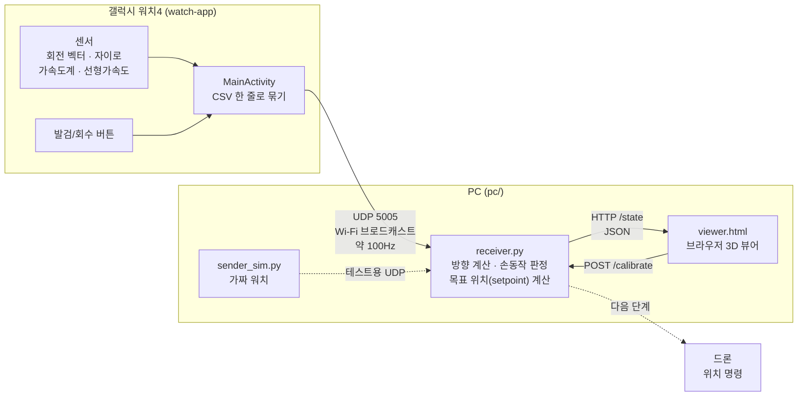
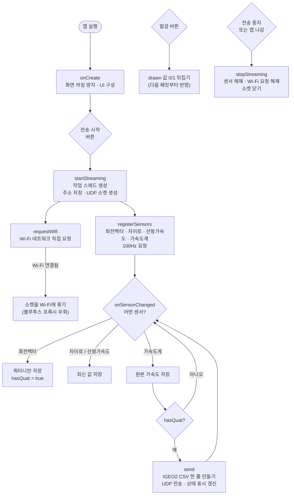
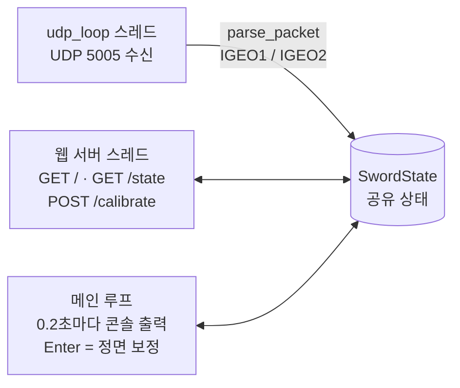
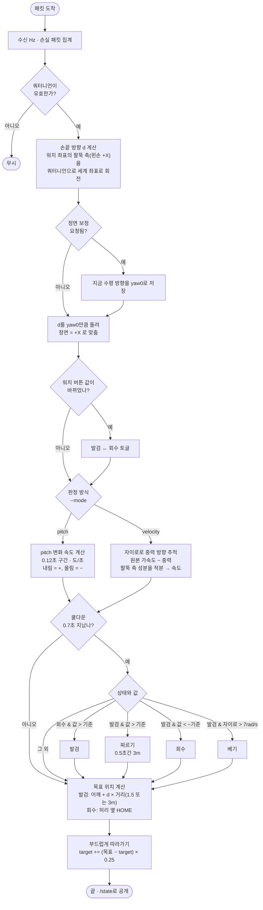
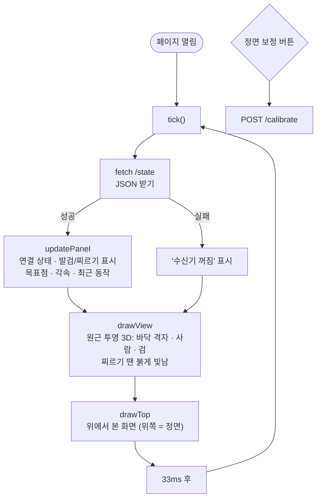
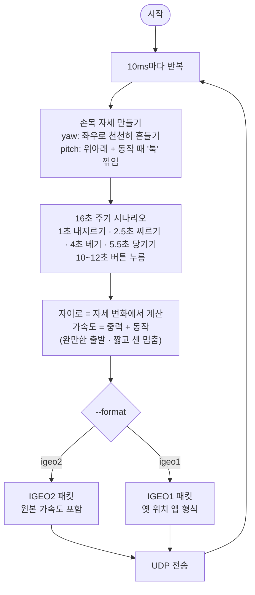

# uav_sword — 以氣御劍 손목 컨트롤러

무협지의 **이기어검(以氣御劍)**, 즉 손을 대지 않고 기(氣)로 검을 날려 부리는 무공을 드론으로 구현해 보는 프로젝트입니다.

이 저장소는 그 **1단계**입니다. **갤럭시 워치4**로 손목의 방향과 동작을 읽어 PC로 보내고, PC에서 검(나중엔 드론)이 가야 할 **목표 위치**를 계산해 브라우저에 3D로 보여줍니다.

| 기능 | 상태 |
|---|---|
| 워치 → PC 실시간 전송 (Wi-Fi UDP, 약 100Hz) | ✅ 실제 워치4에서 확인 |
| 손이 가리키는 방향으로 검 조준 | ✅ 실제 워치4에서 확인 |
| 손동작으로 발검 (팔끝을 아래로 툭) | ✅ 실제 워치4에서 확인 (각속 약 +250°/s) |
| 찌르기 / 베기 / 회수 손동작 | 🟡 시뮬레이터로 확인, 실제 손목 튜닝 중 |
| 실제 드론 제어 | ⬜ 다음 단계 |

---

## 목차
1. [전체 구조](#1-전체-구조)
2. [폴더 구성](#2-폴더-구성)
3. [빠른 시작: 워치 없이 돌려보기](#3-빠른-시작-워치-없이-돌려보기)
4. [워치 앱 빌드와 설치](#4-워치-앱-빌드와-설치)
5. [사용법](#5-사용법)
6. [코드 동작 흐름 (flowchart)](#6-코드-동작-흐름-flowchart)
7. [패킷 형식](#7-패킷-형식)
8. [튜닝 값](#8-튜닝-값)
9. [문제 해결](#9-문제-해결)
10. [다음 단계](#10-다음-단계)

개발 중 시행착오와 판단 근거는 [docs/devlog.md](docs/devlog.md)에 따로 정리되어 있습니다.

---

## 1. 전체 구조



---

## 2. 폴더 구성

```
uav_sword/
├── README.md
├── docs/
│   └── devlog.md              개발 기록 (시행착오와 판단 근거)
├── pc/                        PC 쪽 (Python 3만 있으면 됨, 추가 설치 없음)
│   ├── receiver.py            UDP 수신 · 방향 계산 · 손동작 판정 · 웹 서버
│   ├── viewer.html            브라우저 3D 뷰어
│   └── sender_sim.py          워치 없이 테스트하는 가짜 워치
└── watch-app/                 Wear OS 앱 (Kotlin, 외부 라이브러리 없음)
    ├── settings.gradle.kts
    ├── build.gradle.kts
    └── app/
        ├── build.gradle.kts
        └── src/main/
            ├── AndroidManifest.xml
            └── java/com/igeo/wristsword/MainActivity.kt
```

---

## 3. 빠른 시작: 워치 없이 돌려보기

저장소 최상위 폴더에서 수신기를 켭니다.
```powershell
python pc\receiver.py
```
다른 PowerShell 창에서 가짜 워치를 켭니다.
```powershell
python pc\sender_sim.py
```
브라우저로 **http://127.0.0.1:8000** 을 엽니다.

> `localhost`로는 안 열리는 PC가 있습니다. 항상 `127.0.0.1`을 쓰세요.

검이 좌우로 흔들리면서 **내지르기(발검) → 찌르기 → 베기 → 당기기(회수)**가 반복되고, 10초와 12초에는 워치 버튼을 누른 것처럼 발검과 회수가 일어납니다(16초 주기).

> 실제 워치가 같은 Wi-Fi에서 전송 중이면 가짜 워치와 데이터가 섞입니다. 그럴 땐 둘 다 `--port 5099`처럼 다른 포트를 쓰세요.

---

## 4. 워치 앱 빌드와 설치

> 갤럭시 워치4부터는 OS가 **Wear OS(손목용 안드로이드)**라서 **Android Studio**로 개발합니다.
> 삼성 *Watch Face Studio*는 워치페이스 디자인 전용이고, *Tizen Studio*는 워치3 이하용이라 이 프로젝트에는 쓰지 않습니다.

### 4-1. 빌드
1. [Android Studio](https://developer.android.com/studio)를 설치합니다. 처음 실행할 때 Setup Wizard에서 **Standard**를 고르세요.
2. **File → Open**에서 반드시 **`uav_sword\watch-app` 폴더**를 엽니다. 저장소 최상위 폴더를 열면 프로젝트로 인식되지 않습니다.
3. 오른쪽 아래 **Gradle Sync**가 끝날 때까지 기다립니다. 처음에는 5~10분쯤 걸립니다.
   - *Failed to find target android-34*가 뜨면 **Tools → SDK Manager**에서 **Android 14 (API 34)**를 설치합니다.
   - *AGP Upgrade Assistant*는 닫아도 됩니다.
4. **Build → Make Project** (`Ctrl+F9`)를 누르고, **Build Output** 탭에 `BUILD SUCCESSFUL`이 뜨는지 확인합니다.
   - Build Analyzer의 *Configuration cache*, *Windows Defender* 경고는 속도 관련 권장사항이라 무시해도 됩니다.

### 4-2. 워치 개발자 모드
1. 워치에서 **설정 → 워치 정보 → 소프트웨어 정보 → 소프트웨어 버전**을 7번 탭합니다.
2. **설정 → 개발자 옵션**에서 **ADB 디버깅**과 **무선 디버깅**을 켭니다.
3. PC와 워치를 **같은 Wi-Fi**에 연결합니다. 회사나 학교 Wi-Fi처럼 기기끼리 통신이 막혀 있으면, 폰 핫스팟에 둘 다 연결하세요.

### 4-3. 무선 연결 (PowerShell 사용)
워치4는 구버전 무선 디버깅(*ADB Wi-Fi v1.0*)이라 Android Studio의 **Pair Devices Using Wi-Fi** 창이 *Waiting for ... to enter pairing mode*에서 멈춥니다. 그래서 **PowerShell에서 직접 연결합니다.**

**① 페어링 (처음 한 번만)**
워치에서 **무선 디버깅 → 새 기기 페어링**을 누르면 화면에 두 가지가 나옵니다.
```
Wi-Fi 페어링 코드     ######              ← 6자리 코드
IP 주소 및 포트       192.168.x.x:PPPPP   ← 페어링용 주소
```
그 주소로 페어링을 시작합니다.
```powershell
& "$env:LOCALAPPDATA\Android\Sdk\platform-tools\adb.exe" pair 192.168.x.x:PPPPP
```
`Enter pairing code:`에는 **포트 번호가 아니라 6자리 코드**를 입력합니다. 이 화면이 열려 있는 동안에만 코드가 유효합니다.

**② 연결 (매번)**
워치의 **무선 디버깅 첫 화면**에 나온 IP:포트로 연결합니다. 이 포트는 페어링 포트와 **다릅니다.**
```powershell
& "$env:LOCALAPPDATA\Android\Sdk\platform-tools\adb.exe" connect 192.168.x.x:CCCCC
```
연결됐는지 확인합니다.
```powershell
& "$env:LOCALAPPDATA\Android\Sdk\platform-tools\adb.exe" devices
```

**③ 설치**
Android Studio 위쪽 기기 목록에서 **SM-R870**(워치4)을 고르고 **▶ Run**을 누릅니다.
기본으로 선택된 *Medium Phone* 같은 에뮬레이터를 고르면 안 됩니다. 이 앱은 워치 전용입니다.

> 무선 디버깅을 껐다 켜면 연결 포트가 바뀝니다. 그때는 ②만 새 포트로 다시 하면 됩니다.

---

## 5. 사용법

### 5-1. 실행
1. PC에서 수신기를 켭니다. 워치를 오른손에 찼다면 `--hand right`를 붙입니다.
   ```powershell
   python pc\receiver.py
   ```
   처음 실행할 때 Windows 방화벽 창이 뜨면 **개인 네트워크 허용**을 누르세요.
2. 브라우저로 **http://127.0.0.1:8000** 을 엽니다.
3. 워치에서 **이기어검 밴드** 앱을 열고 **전송 시작**을 누릅니다.
   - 워치 상태가 `Wi-Fi · 약 100 Hz`로 바뀌고, 뷰어 위쪽이 `연결 · 약 100 Hz`로 바뀌면 정상입니다.
   - 주소칸 기본값 `255.255.255.255`는 같은 Wi-Fi 전체에 보낸다는 뜻입니다. 공유기가 막으면 PC의 IP(`ipconfig`로 확인)를 넣으세요.
4. 팔을 몸 정면으로 쭉 뻗은 채 뷰어의 **정면 보정**을 누릅니다. 콘솔에서 Enter를 눌러도 됩니다.

### 5-2. 손동작
| 지금 상태 | 동작 | 결과 |
|---|---|---|
| 회수 | 팔끝을 아래로 **툭** 내리며 내지르기 | **발검**: 검이 손이 가리키는 곳 1.5m 앞으로 날아감 |
| 발검 | 다시 아래로 **툭** | **찌르기**: 검이 3m까지 뻗었다가 0.5초 뒤 돌아옴 |
| 발검 | 팔끝을 위로 **홱** 들며 당기기 | **회수**: 검이 허리 오른쪽 옆으로 돌아옴 |
| 발검 | 손목을 빠르게 **휘두르기** | **베기** |
| 언제나 | 워치 **발검/회수 버튼** | 누를 때마다 발검과 회수가 **서로 바뀜** |

- 판정은 팔 각도가 **빠르게** 바뀌는 것만 봅니다. 검을 겨누려고 팔을 천천히 움직이는 건 무시합니다.
- 손동작으로 상태가 바뀐 뒤에는 워치 버튼 글자와 실제 상태가 다를 수 있습니다. 실제 상태는 뷰어 위쪽에 표시됩니다.

### 5-3. 명령행 옵션 (`pc/receiver.py`)
| 옵션 | 기본값 | 설명 |
|---|---|---|
| `--hand left\|right` | `left` | 워치를 찬 손 |
| `--mode pitch\|velocity` | `pitch` | 손동작 판정 방식 ([6-2](#6-2-pcreceiverpy) 참고) |
| `--thrust N` | pitch: 120°/s, velocity: 0.8 m/s | 내지르기(발검·찌르기) 기준. 낮을수록 잘 걸림 |
| `--pull N` | pitch: 120°/s, velocity: 0.8 m/s | 당기기(회수) 기준 |
| `--port N` | `5005` | UDP 수신 포트 (워치 앱과 같아야 함) |
| `--web-port N` | `8000` | 뷰어 주소 포트 |
| `--no-web` | | 뷰어 없이 콘솔만 |
| `--duration N` | | N초 후 자동 종료 (테스트용) |

`pc/sender_sim.py`는 `--port`, `--format igeo1|igeo2`(옛/새 워치 앱 흉내), `--duration`을 받습니다.

### 5-4. 화면 읽는 법
콘솔에는 0.2초마다 한 줄씩 나옵니다.
```
[연결  98.0Hz 손실 0] 발검  방향 yaw  12.3° pitch  5.1°  목표 ( 1.45,  0.31,  1.53)  각속 +250.00/-30.00 °/s (기준 +120.00/-120.00, pitch, 원본)
```
- `손실`: 중간에 빠진 패킷 수
- `방향`: 손이 가리키는 방향. yaw는 좌우(+는 왼쪽), pitch는 위아래(+는 위)
- `목표`: 검(드론)이 가야 할 위치 (m). x는 앞, y는 왼쪽, z는 위
- `각속 +a/-b`: 최근 1초 동안 팔 각도 변화 속도의 최대(내리는 쪽)와 최소(올리는 쪽). **감도를 맞출 때 이 숫자를 봅니다.**

---

## 6. 코드 동작 흐름 (flowchart)

### 6-1. `watch-app/.../MainActivity.kt`
워치에서 센서 값을 읽어 PC로 보내는 앱입니다. 센서 콜백과 네트워크 전송은 모두 별도 스레드(`HandlerThread`)에서 처리합니다.



핵심 포인트
- **패킷은 가속도계 이벤트마다** 보냅니다. 가속도 순간 최대치를 놓치지 않기 위해서입니다.
- 워치는 폰과 블루투스로 연결돼 있으면 폰을 거쳐 통신해서, 같은 공유기의 PC로 UDP가 가지 않습니다. 그래서 `requestWifi`로 Wi-Fi를 직접 켜고, 소켓을 거기에 묶습니다.
- 첫 자세 값(쿼터니언)이 오기 전에는 보내지 않습니다(`hasQuat`).

### 6-2. `pc/receiver.py`
세 개의 흐름이 동시에 돕니다. UDP 수신 스레드, 웹 서버 스레드, 그리고 콘솔 출력을 맡는 메인 루프입니다. 모두 `SwordState` 하나를 잠금(lock)으로 공유합니다.



패킷 하나가 들어올 때마다 실행되는 `SwordState.update()`의 흐름입니다.



핵심 포인트
- **정면 보정**: 워치의 회전 센서는 지자기를 쓰지 않아서(실내에서 덜 튐) 북쪽 기준이 없습니다. 그래서 "지금 팔이 가리키는 방향 = 정면"으로 맞춥니다.
- **쿨다운**: 팔을 내리꽂으면 곧바로 원래 각도로 돌아오면서 반대 방향 움직임이 생깁니다. 이걸 회수로 착각하지 않도록, 동작 하나를 감지하면 0.7초 동안 다음 판정을 막습니다.
- **목표 위치(`setpoint`)**: x, y, z(m)와 yaw(도)입니다. 나중에 이 값이 그대로 드론 위치 명령이 됩니다.

### 6-3. `pc/viewer.html`


### 6-4. `pc/sender_sim.py`


---

## 7. 패킷 형식

CSV 한 줄짜리 UDP 패킷이고, 기본 포트는 5005입니다.

```
IGEO2,seq,t_ms,qw,qx,qy,qz,gx,gy,gz,lax,lay,laz,drawn,ax,ay,az
```

| 필드 | 단위 | 설명 |
|---|---|---|
| `seq` | | 일련번호 (손실 확인용) |
| `t_ms` | ms | 워치 센서 시각 |
| `qw..qz` | | 워치 좌표 → 세계 좌표 회전 (세계 Z = 위) |
| `gx..gz` | rad/s | 자이로 (워치 좌표) |
| `lax..laz` | m/s² | 기기가 계산한 선형가속도. 걸러진 값이라 작게 나옴 |
| `drawn` | 0/1 | 워치 발검 버튼 값 (누를 때마다 바뀜) |
| `ax..az` | m/s² | 원본 가속도계 값 (중력 포함) |

옛 형식 `IGEO1`은 앞의 14칸(`drawn`까지)만 있습니다. 수신기는 두 형식을 모두 받습니다.

워치 좌표계: 화면을 정면으로 볼 때 **+X = 3시 방향, +Y = 12시 방향, +Z = 화면 밖**입니다. 왼손에 차면 3시 방향(+X)이 손끝을 향합니다.

---

## 8. 튜닝 값

`pc/receiver.py`의 `SwordState` 맨 위에 있습니다.

| 값 | 기본 | 의미 |
|---|---|---|
| `PITCH_FLICK` | 120 °/s | pitch 방식 기준. 실제 워치4에서 발검 시 약 +250°/s가 나왔음 |
| `PITCH_WINDOW` | 0.12 s | 각도 변화 속도를 재는 구간 |
| `GESTURE_COOLDOWN` | 0.7 s | 동작 직후 다음 판정을 막는 시간 |
| `REACH` / `THRUST_REACH` | 1.5 / 3.0 m | 평소/찌르기 때 검까지 거리 |
| `THRUST_TIME` | 0.5 s | 찌르기 유지 시간 |
| `SLASH_GYRO` | 7 rad/s | 베기 판정 각속도 |
| `SMOOTH` | 0.25 | 목표 위치를 따라가는 부드러움 (작을수록 부드럽지만 느림) |
| `HOME` | (0.3, −0.5, 1.0) m | 회수 위치 (허리 오른쪽 옆) |
| `SHOULDER` | (0, 0, 1.4) m | 검이 뻗어 나가는 기준점 |
| `THRUST_VEL` / `PULL_VEL` | 0.8 m/s | velocity 방식 기준 |
| `VEL_TAU` | 0.3 s | velocity 방식: 속도 추정이 0으로 돌아오는 시간 |
| `GRAVITY_TAU` | 1.0 s | velocity 방식: 자이로로 추적한 중력을 원본 가속도 쪽으로 보정하는 시간 |
| `THRUST_ACCEL_LIN` / `PULL_ACCEL_LIN` | 3 m/s² | 옛 워치 앱(IGEO1)을 쓸 때의 기준 |

---

## 9. 문제 해결

| 증상 | 원인 / 해결 |
|---|---|
| 뷰어가 안 열림 | `localhost` 대신 **http://127.0.0.1:8000** 으로 엽니다. 8000번을 다른 프로그램이 쓰면 `--web-port 8765`로 바꿉니다 |
| 뷰어가 계속 "연결 안 됨" | 방화벽에서 Python을 허용했는지 확인합니다. 워치 주소칸에 PC IP를 직접 넣어 봅니다 |
| 워치 상태가 `Wi-Fi 대기`에서 멈춤 | 워치 Wi-Fi 연결을 확인합니다. 안 되면 워치 블루투스를 잠시 끄면 Wi-Fi로 전환됩니다 |
| 발검이 안 걸림 / 너무 잘 걸림 | 콘솔의 `각속 +a/-b`를 보고 `--thrust`와 `--pull`을 그보다 조금 낮게(또는 높게) 줍니다 |
| 팔을 올리면 검이 내려감 | `--hand`를 반대로 줍니다 |
| 방향이 천천히 돌아감 | 회전 센서 드리프트입니다. **정면 보정**을 다시 누르세요 |
| Hz가 낮음 | 워치 화면을 켠 채로 두고, 절전 모드를 끕니다 |
| Android Studio 페어링 창이 안 넘어감 | 워치4는 ADB Wi-Fi v1.0입니다. [4-3](#4-3-무선-연결-powershell-사용)처럼 PowerShell로 연결합니다 |
| `adb pair`에서 `protocol fault` | 코드 자리에 포트 번호를 넣은 경우입니다. 6자리 **페어링 코드**를 넣으세요 |
| 앱이 폰에 설치 안 됨 | 정상입니다. 워치 전용 앱입니다 |

---

## 10. 다음 단계

1. **찌르기 · 베기 · 회수 실제 튜닝**: 콘솔 숫자를 보며 기준값을 맞춥니다.
2. **실제 드론 연결**: `setpoint`(x, y, z, yaw)를 실내 위치 추적이 되는 소형 드론(예: Crazyflie + Lighthouse)에 위치 명령으로 보냅니다.
3. **검 모양 프레임**: 칼날 면에 덕트형 소형 프로펠러를 넣은 검 형태의 기체를 만듭니다.
4. **여러 자루 (검진)**: 군집 제어로 여러 대를 함께 움직입니다.

### 안전과 규정
- 칼날은 반드시 **무딘 소재**로 만들고, 프로펠러는 **덕트나 가드**로 감쌉니다.
- 개발은 **실내 그물망 안**에서 합니다.
- 서울 한강 일대는 대부분 비행금지·제한구역이라 **수도방위사령부 비행승인**(드론 원스톱 민원서비스)이 필요하고, 촬영하려면 촬영 허가도 따로 받아야 합니다. 야외 시연은 지정된 **한강 드론공원**을 먼저 알아보세요.
- 규정은 자주 바뀌니 날리기 전에 국토교통부·한국교통안전공단의 **Ready to fly** 앱으로 그 위치를 확인하세요.
