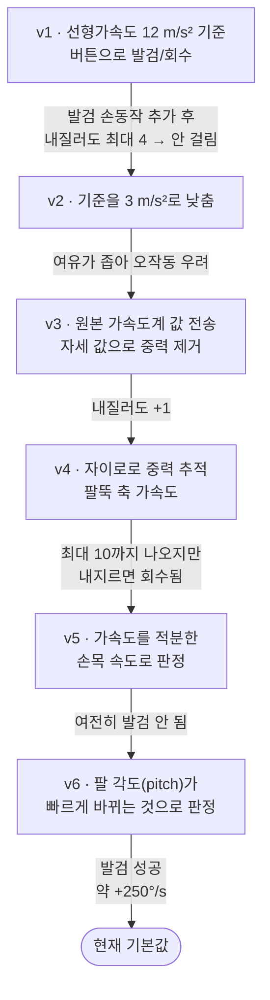

# 개발 기록

이 프로젝트를 만들면서 내린 결정과 시행착오를 순서대로 정리합니다.
코드만 보면 "왜 이렇게 했지?" 싶은 부분의 이유가 여기 있습니다.

---

## 1. 구상: 이기어검을 드론으로

**목표**: 손짓으로 검 모양 비행체를 조종합니다. 무협지처럼 빠르고 날카롭게 찌르는 건 물리 법칙과 안전 문제 때문에 어렵기 때문에 **공연·연출용 장치**를 목표로 합니다.

### 검 몸체를 띄우는 방식
| 방식 | 판단 |
|---|---|
| **검 모양 프레임 + 내장 프로펠러** (칼날 면에 덕트형 소형 프로펠러, 검 길이 방향으로 나란히 배치) | **채택 예정.** 현실적이고, 검끝이 진행 방향을 향해 날아가는 느낌이 납니다 |
| 손잡이 쪽 덕트팬 하나 + 추력 방향 조절 | 보기엔 제일 그럴듯하지만 제어가 매우 어렵습니다 |
| 드론이 검을 매달고 비행 | 쉽지만 "기로 다룬다"는 맛이 없습니다 |

### 개발 순서
1. 손 동작 → 화면 속 검 (시뮬레이션) ← **현재 저장소**
2. 실내 위치 추적이 되는 기성 소형 드론(예: Crazyflie)으로 검증
3. 검 모양 프레임 제작
4. 여러 자루를 군집 제어 (검진)

---

## 2. 입력 장치: 왜 갤럭시 워치인가

손목 IMU 밴드(ESP32 + 관성센서)도 검토했습니다.

| 선택지 | 대략 비용 | 비고 |
|---|---|---|
| ESP32 + MPU6050 | 1~3만 원 | 가장 저렴하지만 자세 계산을 직접 짜야 함 |
| ESP32 + BNO085 | 4~6만 원 | 센서가 자세를 바로 계산해 줌 |
| M5StickC Plus2 | 3~4만 원 | ESP32 · IMU · 배터리 · 화면 일체형 |
| **갤럭시 워치4** | **이미 있음** | Wear OS라 안드로이드 API로 센서를 읽을 수 있음 → **채택** |

워치의 한계도 확인했습니다.
- **손가락 모양은 못 읽습니다.** 그래서 검결지(劍訣指) 대신 버튼과 팔 동작으로 명령합니다.
- 화면이 꺼지면 센서가 느려지거나 멈춥니다 → 앱이 화면을 켜 둡니다.
- 워치3 이하는 Tizen OS라 해당되지 않습니다. 워치4부터는 Wear OS라 **Android Studio**로 개발합니다(Watch Face Studio는 워치페이스 전용).

---

## 3. 통신 설계

- **UDP 브로드캐스트(255.255.255.255:5005)**: 워치에서 PC IP를 입력하지 않아도 됩니다. 공유기가 막으면 PC IP를 직접 넣습니다.
- **Wi-Fi 강제 사용**: 갤럭시 워치는 폰과 블루투스로 연결돼 있으면 Wi-Fi를 끄고 폰을 거쳐 통신합니다. 그 경로로는 같은 공유기의 PC로 UDP가 가지 않아서, `ConnectivityManager.requestNetwork(TRANSPORT_WIFI)`로 Wi-Fi를 직접 요청하고 소켓을 거기에 묶습니다.
- **CSV 텍스트 패킷**: 사람이 읽고 디버깅하기 쉽습니다. 100Hz 정도면 크기는 문제가 되지 않습니다.
- **Game Rotation Vector**: 지자기를 쓰지 않아서 실내 철골이나 전자기기 근처에서 덜 튑니다. 대신 북쪽 기준이 없으니 PC에서 **정면 보정**을 합니다.

---

## 4. 설치 과정에서 막혔던 것들

| 막힌 곳 | 원인 | 해결 |
|---|---|---|
| 프로젝트를 열어도 인식 안 됨 | 저장소 최상위 폴더를 열었음 | `watch-app` 폴더를 엽니다 |
| ▶ Run이 엉뚱한 곳으로 | 기기 목록 기본값이 *Medium Phone* 에뮬레이터 | 워치(SM-R870)를 고릅니다 |
| Android Studio 페어링 창이 *Waiting...*에서 멈춤 | 워치4는 **ADB Wi-Fi v1.0**이라 Studio의 자동 페어링이 안 붙음 | PowerShell에서 `adb pair` → `adb connect` |
| `adb pair`에서 `protocol fault` | 페어링 코드 자리에 **포트 번호**를 입력함 | 워치 화면의 **6자리 코드**를 입력 |
| 연결 포트가 안 맞음 | 페어링 포트와 연결 포트는 다름 | 무선 디버깅 **첫 화면**의 포트로 `adb connect` |
| 폰에 깔아서 워치로 넘기기 | 지금 Wear OS에는 폰 앱에 워치 앱을 넣어 자동 설치하는 기능이 없음 (Play 스토어 경로만 있음) | PC에서 ADB로 직접 설치 |
| 뷰어가 `localhost:8000`에서 안 열림 | 일부 환경에서 `localhost`가 IPv6(`::1`)로 연결됨 (서버는 IPv4 127.0.0.1에서만 대기) | `127.0.0.1:8000`으로 엽니다 |
| 한국어 Windows 콘솔에서 수신기가 죽음 | `⚔` 문자가 cp949로 인코딩되지 않음 | 문자를 바꾸고, 출력에 `errors="replace"` 적용 |
| 시뮬레이터 테스트 값이 이상함 (194Hz, 손실 수천) | 실제 워치가 같은 포트로 브로드캐스트 중이라 데이터가 섞임 | 시뮬레이터 테스트는 다른 포트(`--port 5099`)로 |

---

## 5. 손동작 판정의 변천사 ⭐

이 프로젝트에서 시간이 가장 많이 든 부분입니다. 실제 워치4에서 측정한 값을 보면서 판정 방식을 여섯 번 바꿨습니다.



### v1 — 선형가속도 12 m/s² (버튼 발검)
처음에는 워치 버튼으로 발검/회수를 하고, 손목을 앞으로 내지르면 찌르기로 판정했습니다. 기준은 손끝 방향 선형가속도 12 m/s²였습니다.

### v1.5 — 당기기로 회수 추가
"손목을 당겨 회수" 요청으로 손동작 상태 기계를 만들었습니다.
- 회수 상태에서 내지르기 → 발검 / 발검 상태에서 내지르기 → 찌르기 / 당기기 → 회수
- **쿨다운 0.7초**: 내지른 팔이 멈출 때 생기는 반대 방향 가속을 회수로 착각하지 않게 했습니다.
- 워치 버튼은 누를 때마다 상태를 **토글**하는 방식으로 바꿨습니다(손동작과 공존).

**결과**: 실제 워치에서 발검이 안 됐습니다. 진단용으로 최근 1초 동안 손끝 방향 가속도의 최대·최소를 화면에 띄워 보니, **세게 내질러도 최대 4 정도**였습니다.

### v2 — 기준을 3 m/s²로
갤럭시 워치4의 `TYPE_LINEAR_ACCELERATION`은 **기기가 걸러서 부드럽게 만든 값**이라 순간 최대치가 크게 깎입니다. 기준을 3으로 낮추고 `--thrust`, `--pull` 옵션을 추가했습니다.

**문제**: 의도한 동작(4)과 그냥 팔 움직임 사이 여유가 너무 좁았습니다.

### v3 — 원본 가속도계 전송 (IGEO2 패킷)
워치 앱이 `TYPE_ACCELEROMETER` 원본 값을 함께 보내게 고쳤습니다. 순간 최대치를 놓치지 않도록 **가속도계 이벤트마다 패킷을 보냅니다**. PC에서는 원본 값을 워치의 자세(쿼터니언)로 세계 좌표로 돌린 뒤, 천천히 변하는 성분(중력)을 빼려고 했습니다.

**결과**: 내질러도 **+1**밖에 안 나왔습니다.

워치가 실제로 이 PC로 전송 중이어서 3초 동안 원본 패킷을 직접 받아 보니, 100Hz에 299개 샘플이 모두 달랐고 정지 시 중력 크기도 9.7~9.9로 **원본 데이터는 정상**이었습니다. 문제는 처리 방식이었습니다.

**원인**: 워치의 자세 계산(센서 퓨전)은 **빠른 가속을 "기울어졌다"고 착각합니다.** 그 자세로 중력을 빼면 손 움직임까지 같이 지워집니다. 사용자가 관찰한 "내지르면 pitch가 내려간다"도 같은 현상입니다.

### v4 — 자이로로 중력 추적
자세 값을 쓰지 않고, **워치 좌표계에서 중력 방향을 자이로로 직접 돌리며 추적**했습니다.

```
dg/dt = −ω × g          (ω = 자이로, g = 워치 좌표계의 중력)
g ← g + (원본 가속도 − g) × dt / (1초 + dt)   (오차가 쌓이지 않게 천천히 보정)
손 가속도 = 원본 가속도 − g,   손끝 방향 성분 = 팔뚝 축(+X) 성분
```

**결과**: 최대 10까지 나왔지만 **내지르면 회수가 됐습니다.**

### v5 — 손목 속도로 판정
**원인**: 실제 내지르기는 **출발이 완만하고(+) 멈춤이 짧고 셉니다(−).** 그래서 가속도의 가장 큰 값은 오히려 멈추는 순간의 반대 방향으로 나옵니다.

그래서 가속도를 적분해서 **속도**로 판정했습니다. 오차가 쌓이지 않게 0.3초 시간상수로 서서히 잊게 했습니다. 속도는 내지르는 동안 계속 +라서 방향이 헷갈리지 않습니다. 시뮬레이터에도 "완만한 출발 + 짧고 센 멈춤" 동작을 넣어 확인했습니다.

**결과**: 실제 워치에서는 여전히 발검이 안 됐습니다.

### v6 — 팔 각도(pitch)의 빠른 변화 ✅
사용자가 제안한 방식입니다. 처음부터 일관되게 관찰된 현상을 그대로 썼습니다.
- 내지르기 → pitch가 **빠르게 내려감**
- 당기기 → pitch가 **빠르게 올라감**
- 천천히 팔을 올리고 내리기 → 느리게 변함 → 무시

0.12초 구간에서 pitch 변화 속도(°/s)를 재고, 120°/s를 넘으면 판정합니다. 쿨다운 0.7초는 그대로 둬서, 꺾였던 각도가 원래대로 돌아오는 움직임을 반대 동작으로 착각하지 않습니다.

**결과**: **실제 워치4에서 발검 성공. 내지를 때 각속 약 +250°/s** (기준 120°/s의 두 배 정도라 여유가 충분합니다).

### 교훈
- 센서 값은 **실제 기기로 먼저 측정**하고 기준을 정해야 합니다. 시뮬레이터는 내가 상상한 동작만 흉내 냅니다.
- 워치 내부의 "친절한" 가공값(선형가속도, 퓨전된 자세)은 빠른 동작에서 왜곡됩니다.
- 진단용 숫자를 화면에 띄우는 기능이 원인을 찾는 데 가장 큰 도움이 됐습니다.
- velocity 방식(`--mode velocity`)은 이론적으로 더 정교해서 남겨 두었습니다. 실제 데이터를 녹화해 분석하면 다시 쓸 수 있을지도 모릅니다.

---

## 6. 드론 비행 관련 메모

- **서울 한강 일대**: 대부분 P-73 비행금지구역이나 R-75 비행제한구역이고, 서쪽은 김포공항 관제권입니다. 승인은 **수도방위사령부** 담당이며(경찰청 아님), **드론 원스톱 민원서비스**에서 신청합니다.
- **촬영 허가**는 비행승인과 별도입니다(국방부 항공촬영 허가).
- **한강 드론공원**(광나루, 신정교 하부, 가양대교 북단 등)에서는 일정 무게 이하 취미용 드론을 승인 없이 날릴 수 있었습니다. 운영 여부와 기준은 다시 확인해야 합니다.
- 기본 규칙: 고도 150m 이하, 군중 위 비행 금지, 육안 거리 안에서만 비행, 야간 비행은 별도 승인.
- 규정은 자주 바뀌니 **Ready to fly** 앱으로 위치를 확인합니다.
- 칼날은 무딘 소재로 만듭니다. 날카로운 날을 달면 무기화된 드론이 되어 법적으로 문제가 됩니다.
